<a href="https://malikontech.com">malikontech.com</a> &nbsp;·&nbsp; <a href="https://x.com/malikontech">@malikontech</a> &nbsp;·&nbsp; <a href="https://www.youtube.com/@MalikonTech">YouTube</a> &nbsp;·&nbsp; <a href="https://www.tiktok.com/@malikontech">TikTok</a> &nbsp;·&nbsp; <a href="https://www.instagram.com/malikontechnology">Instagram</a>

<a href="https://github.com/Open-Champions/champions-return-to-arms-re"></a><a href="https://github.com/TrustlessMike/Jam"></a><a href="https://github.com/TrustlessMike/stack-app"></a><a href="https://github.com/TrustlessMike/Kashout"></a><a href="https://github.com/TrustlessMike/Wickett"></a><a href="https://github.com/TrustlessMike/art-of-battle"></a><a href="https://github.com/TrustlessMike/opencontroller"></a><a href="https://github.com/TrustlessMike/vibe-guild"></a><a href="https://github.com/TrustlessMike/dispo-spinner"></a><a href="https://malikontech.com"></a>

Each project documents its current scope and limitations. Clear bug reports and focused contributions are welcome.

